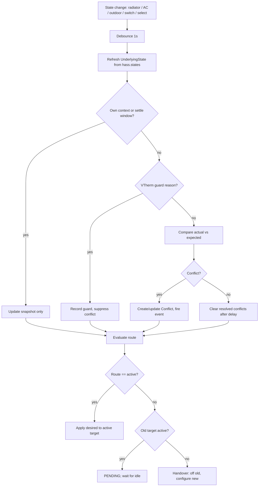
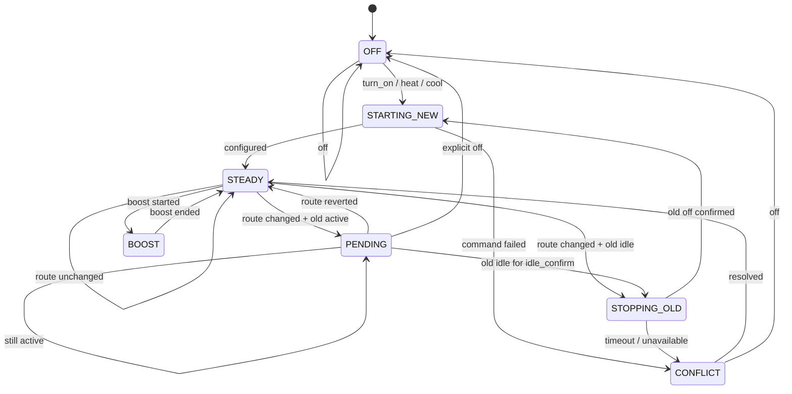

# Architecture

This document describes the technical design behind the plan in [`PLAN.md`](PLAN.md).

## 1. Layers

```text
┌────────────────────────────────────────────────────────────────────┐
│ Interface layer                                                    │
│  climate.py · binary_sensor.py · sensor.py · button.py · select.py │
│  Thin adapters: read RouterSnapshot, call coordinator methods.     │
└───────────────────────────────┬────────────────────────────────────┘
                                │
┌───────────────────────────────▼────────────────────────────────────┐
│ Orchestration layer                                                │
│  coordinator.py                                                    │
│  Event listeners, watchdog, command lock, persistence, events.     │
│  Owns the handover state machine and the desired state.            │
└───────────────────────────────┬────────────────────────────────────┘
                                │
┌───────────────────────────────▼────────────────────────────────────┐
│ Domain layer (pure, HA-light)                                      │
│  router.py · models.py                                             │
│  Route decision, hysteresis, override baseline/expiry, conflicts.  │
└───────────────────────────────┬────────────────────────────────────┘
                                │
┌───────────────────────────────▼────────────────────────────────────┐
│ Home Assistant services / state                                    │
│  climate.vtherm_radiator · climate.vtherm_ac · outdoor sensor ·    │
│  manual switch · route override select                             │
└────────────────────────────────────────────────────────────────────┘
```

The domain layer must be testable without a running HA instance. The coordinator is the only layer allowed to
perform service calls and mutate state.

## 2. Core data model

```python
class Target(StrEnum):
    RADIATOR = "radiator"
    AC = "ac"


@dataclass(frozen=True)
class UnderlyingState:
    entity_id: str
    available: bool
    hvac_mode: str | None
    hvac_action: str | None
    preset_mode: str | None
    target_temperature: float | None
    current_temperature: float | None
    min_temp: float | None
    max_temp: float | None
    target_temp_step: float | None
    hvac_modes: tuple[str, ...]
    preset_modes: tuple[str, ...]
    last_updated: datetime | None
    guard: str | None  # window / safety / power / presence / central / auto_start_stop
    timed_preset_active: bool
    raw: dict[str, Any]


@dataclass
class DesiredState:
    hvac_mode: str | None
    setpoint_kind: Literal["preset", "temperature", "none"]
    preset_mode: str | None
    target_temperature: float | None
    fan_mode: str | None = None
    swing_mode: str | None = None


@dataclass
class OverrideState:
    kind: Literal["temperature", "preset", "hvac_mode"]
    value: Any
    until: datetime
    baseline: DesiredState
    started_at: datetime


@dataclass(frozen=True)
class Conflict:
    key: str
    type: str
    target: Target | None
    expected: Any
    actual: Any
    first_seen: datetime
    last_seen: datetime
    source_guess: str
    resolved: bool = False


@dataclass
class RouterSnapshot:
    ready: bool
    available: bool
    active_targets: frozenset[Target]
    pending_target: Target | None
    route_reason: str
    handover_state: str
    desired: DesiredState
    override: OverrideState | None
    boost_until: datetime | None
    conflicts: tuple[Conflict, ...]
    outdoor_temperature: float | None
    outdoor_stale: bool
    manual_switch_state: str | None
    manual_switch_stale: bool
    route_override: str
    last_handover: datetime | None
    last_command: datetime | None
    targets: dict[Target, UnderlyingState]
```

`RouterSnapshot` is immutable enough for entity reads; the coordinator replaces it atomically via
`async_set_updated_data`.

## 3. Coordinator event flow



The coordinator uses one `asyncio.Lock` around route evaluation, command forwarding, and handover. State-change
callbacks only schedule work; they do not perform service calls inline.

## 4. Handover state machine



`old active` means `hvac_mode != off` and `hvac_action in {heating, cooling}`. Unknown action is treated as active.

## 5. Handover sequence with pending command

```mermaid
sequenceDiagram
    participant S as Scheduler
    participant P as Proxy
    participant R as Radiator VTherm
    participant A as AC VTherm

    R-->>P: hvac_action=heating
    S->>P: set_temperature(22)
    P->>P: desired=22; route=AC; old active → PENDING
    P-->>S: pending target=AC, active=radiator

    S->>P: set_preset_mode(comfort)
    P->>P: desired preset=comfort (clears temp)
    Note over P: command queued; not sent to radiator

    R-->>P: hvac_action=idle
    P->>P: wait idle_confirm
    P->>R: set_hvac_mode(off)
    R-->>P: hvac_mode=off
    P->>A: set_hvac_mode(heat)
    P->>A: set_preset_mode(comfort)
    A-->>P: preset=comfort
    P-->>S: active target=AC
```

## 6. Command path

```text
ClimateRouterEntity.async_set_temperature(...)
  └─ coordinator.async_set_temperature(...)
       ├─ validate and update DesiredState
       ├─ acquire lock
       ├─ evaluate route
       ├─ if pending: store desired, update snapshot, return
       ├─ if active: forward service call with internal Context
       ├─ set expected state + settle window
       ├─ update snapshot / write HA state
       └─ release lock
```

The climate entity never calls `hass.services.async_call` directly. This keeps context tracking, locking, and
conflict suppression in one place.

## 7. Context tracking and conflict suppression

```python
ctx = Context()
self._internal_contexts[ctx.id] = monotonic() + 30
await hass.services.async_call(
    "climate",
    "set_temperature",
    {"entity_id": target.entity_id, "temperature": value},
    blocking=True,
    context=ctx,
)
```

When a state-change event arrives:

- If `event.context.id` or `event.context.parent_id` is in `_internal_contexts`, it is our own call.
- Otherwise, if `monotonic() < expected.suppress_until`, compare actual to expected; differences are not conflicts
  yet.
- After the settle window, a difference is a conflict unless a VTherm guard reason explains it.
- Prune expired contexts periodically (watchdog).

This is a heuristic because VTherm may create child contexts or update state asynchronously. The expected-state
window is the fallback.

## 8. Guard classification

A VTherm guard is detected from custom attributes when present:

- `specific_states.hvac_mode_reason` / `hvac_off_reason` in
  `{Window, Safety, Power, Central mode, Auto-start/stop}`.
- `preset_mode` in `{power, safety}`.
- `window_state` / `window_auto_state` on.
- `safety_state` on.
- `overpowering_state` on.
- `timed_preset_manager.is_active` true (underlying override).

Guard changes are surfaced in `extra_state_attributes.targets[target].guard` and do not trigger reassert. They may
still produce a diagnostic `guard` record if they change the active target's mode/preset, but they are not
"conflicts" in the user-facing sense.

## 9. Persistence

`homeassistant.helpers.storage.Store` with key `climaterouter.<entry_id>` and version `1`:

```json
{
  "version": 1,
  "desired": {"hvac_mode": "heat", "setpoint_kind": "preset", "preset_mode": "comfort"},
  "override": {
    "kind": "temperature",
    "value": 22.5,
    "until": "2026-11-06T18:30:00+00:00",
    "baseline": {"hvac_mode": "heat", "setpoint_kind": "preset", "preset_mode": "comfort"}
  },
  "last_route": "radiator",
  "boost_until": null
}
```

- Write after every desired/override/boost change (debounced 1 s).
- On load, discard expired overrides and restore the baseline.
- Do not persist actual target states; read them from HA on startup.
- `async_migrate_entry` handles schema changes.

## 10. Availability model

```text
ready = startup_grace elapsed AND config valid
available = entry loaded AND (any target available OR fallback possible)
```

- If the active target is unavailable and fallback is disabled, `available=false` and conflict sensor on.
- If the outdoor sensor is stale, `available` stays true; route holds.
- If the manual switch is stale, `available` stays true; switch state holds.

## 11. Concurrency rules

- One `asyncio.Lock` per config entry for route evaluation/commands/handover.
- State-change callbacks must not await the lock inline; schedule a task and return.
- Watchdog and event callbacks share the same lock.
- Service handlers return after forwarding or queuing; they do not wait for a handover to complete.
- Handover timeouts use `asyncio.timeout`, not blocking sleeps.
- No more than one in-flight handover per entry.

## 12. Why not a `ClimateEntity` that directly subclasses another entity?

HA entities are not designed to be wrapped by subclassing. A proxy entity with explicit state mirroring is simpler,
safer, and keeps the VTherms independent. It also avoids depending on VTherm internals.

## 13. Why not use `climate_group` or a generic thermostat?

- `climate_group` forwards to all members, not one selected member.
- A generic thermostat would add its own regulation and fight VTherm.
- Neither supports handover, hysteresis, override baselines, or conflict detection.

## 14. Why not put routing in an automation/script?

An automation could call one VTherm or the other, but it would not provide:

- a single stable climate entity for Scheduler;
- state mirroring and availability;
- handover that respects active cycles;
- override baselines and restart persistence;
- conflict detection and diagnostics.

The proxy is the smallest component that provides the required contract.

## 15. File dependency graph

```text
const.py
  ▲
models.py ──► router.py
  ▲             ▲
  │             │
coordinator.py ─┘
  ▲
  ├── climate.py
  ├── binary_sensor.py
  ├── sensor.py
  ├── button.py
  ├── select.py
  ├── services.py
  └── diagnostics.py

config_flow.py ──► const.py
__init__.py ──► coordinator.py, services.py, platforms
```

`router.py` must not import `homeassistant.components.climate` service functions or perform I/O. It may import HA
enums/constants for convenience, but the core functions should accept plain values so tests are fast.
